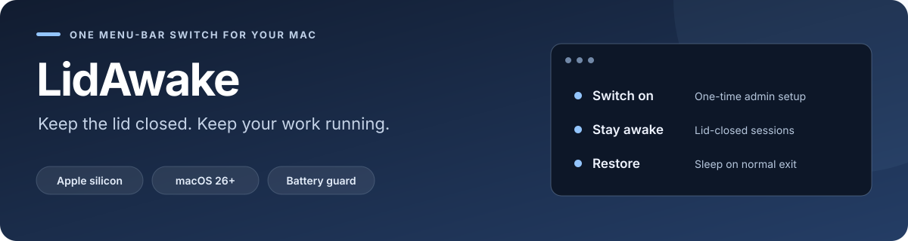
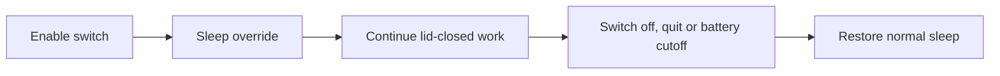

<p align="center"></p>

<p align="center">
  
  
  
</p>

One menu-bar switch to **keep an Apple silicon Mac awake with its lid closed**. Use it for ongoing work after remote access is already configured.

## Use

1. [Download LidAwake.zip](https://github.com/nerdynaman/lidawake/raw/refs/heads/main/release/LidAwake.zip), unzip and open the app.
2. Click **Lid → Keep awake with lid closed** and approve the one-time administrator setup.
3. Wait for **On · battery** or **On · plugged in**, then close the lid. Uncheck the switch or quit to end the session.

When upgrading, switch the old version off, wait for **Off**, and quit before opening the new copy. Downloads are ad hoc signed, not notarized; you can also [build locally](#build).



## Session behavior

| Power | Display | Ending a session |
| --- | --- | --- |
| Works plugged in; on battery, stops at 10% or if charge is unknown | Requests display sleep when the lid is closed; external displays may also turn off | Normal exit restores sleep; opening the lid alone does not end the session |

Administrator setup installs a persistent, fixed helper authorization for your account. It remains after quitting or deleting the app. **[Read permissions, revocation & recovery](docs/USAGE.md#permissions-and-recovery)** before use; forced termination or restoration failure can leave the sleep override enabled.

## Build

Requires Apple’s Command Line Tools. The build targets Apple silicon and macOS 26+.

```sh
git clone https://github.com/nerdynaman/lidawake.git
cd lidawake
./build.sh
open build/LidAwake.app
```

The build uses Apple system frameworks and creates an ad hoc signed app. [Testing & diagnostics](docs/USAGE.md#build-from-source) cover simulated cleanup tests, permission checks and read-only power status.

[Detailed usage & recovery](docs/USAGE.md) · [Session helper](session.sh) · Created in [T3 Code](https://t3.codes)
